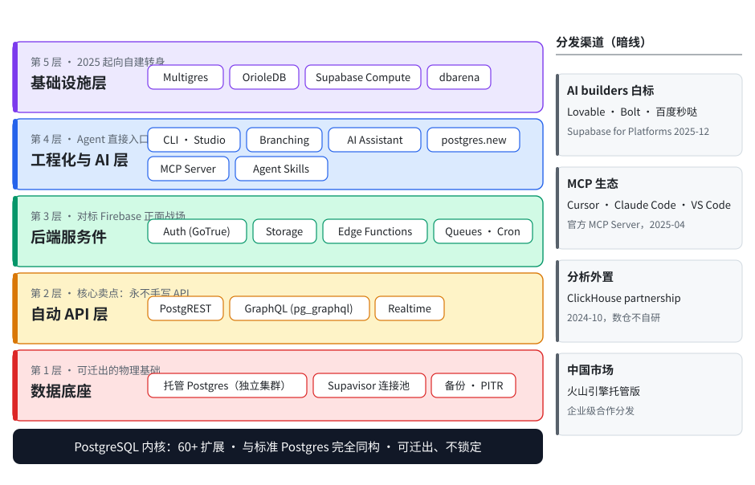
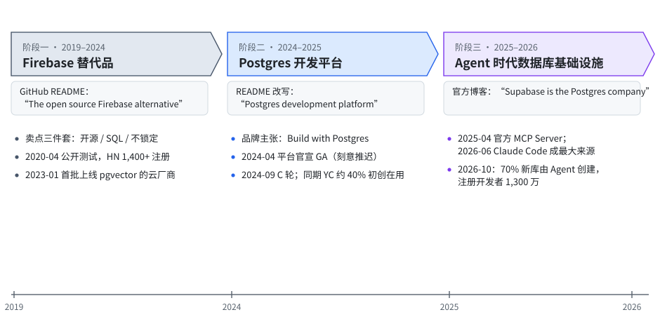
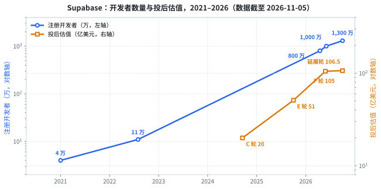

# Supabase 产品全景：从 Firebase 替代品到 AI Agent 的默认数据库

**一句话定位**：Supabase 是以 Postgres 为内核的全栈后端即服务（BaaS）平台——每个项目一个独立 Postgres 集群，外加自动 API、认证、存储、实时、边缘函数六件套。创立七年，它完成三次定位迁移：Firebase 替代品 → Postgres 开发平台 → AI Agent 时代的数据库基础设施。2026 年 10 月官宣收购 Turso、追加 1.5 亿美元融资后，累计融资超 11 亿美元，估值进入百亿美元俱乐部。

**数据截至 2026-11-05**。官方宣称与第三方估算分开标注。

## 关键数字（先给结论）

| 指标 | 数值 | 口径 |
|---|---|---|
| 注册开发者 | 1300 万 | 官方，2026-10 新闻稿 |
| 每月新增用户 | 100 万 | 官方，2026-10 |
| 每月新建数据库 | 400 万+ | 官方，2026-10；第三方 [Latent Space](https://latent.space/feed) 记 500 万 |
| 新建数据库中 Agent/AI 工具创建占比 | 70% | 官方，2026-10；2026-06 披露口径为 60%+，随时间上移 |
| 数据库总量同比增速 | +600% | 官方，2026-06 F 轮披露 |
| 2026 年最大新增用量来源 | Claude Code | 官方，2026-06 |
| 付费客户 | 25 万+ | 第三方汇编（SVIC），非官方口径 |
| ARR | 约 1.7 亿美元 | 第三方估算（Sacra，2026-05），官方未确认 |
| 累计融资 / 估值 | 超 11 亿美元 / 投后约 105 亿美元 | F 轮官方与[byteiota 报道](https://byteiota.com/supabase-multigres-postgres-gets-horizontal-scaling/)；第三方库 multiples.vc 记 110 亿 |

一句话读数：这是一家月增 400 万个数据库、其中七成由 AI Agent 自动创建的公司——它的买家正在从开发者变成 Agent。

## 产品体系：一张五层全景

Supabase 的产品不是一张功能列表，而是围绕 Postgres 的五层同心圆。以下各层组件均为可枚举的实物，非营销概念。

### 第 1 层：数据底座

- **托管 Postgres**：每个项目一个独立 Postgres 集群（非多租户共享实例），支持 60+ 扩展，与标准 Postgres 完全同构——这是它"可迁出、不锁定"叙事的物理基础。
- **连接池 Supavisor**：Elixir 编写的连接池代理，2023 年起全面替换 PgBouncer，主打百万级连接与 serverless 场景。
- **备份与 PITR**：每日备份、时间点恢复（Pro 起可用）。

### 第 2 层：自动 API 层

- **PostgREST**：数据库 schema 自动生成 REST API，权限直接穿透 Postgres 行级安全（RLS）——"永远不再手写 API"是创立至今的核心卖点。
- **GraphQL**：pg_graphql 扩展，同样受 RLS 约束。
- **Realtime**：WebSocket 订阅数据变更，基于逻辑复制槽 + 触发器；广播（Broadcast）与在线状态（Presence）支持 RLS 级授权（2023-12）。

### 第 3 层：后端服务件（对标 Firebase 的正面战场）

- **Auth（GoTrue）**：20+ OAuth 提供商（Google/GitHub/Apple/微信/飞书等）、邮件/短信、JWT 与 RLS 原生集成。
- **Storage**：S3 后端对象存储 + imgproxy 图像处理 + 行列级权限。
- **Edge Functions**：Deno isolate 运行时（`edge-runtime` 已开源），全球边缘部署。
- **Queues / Cron**：2024 年 12 月发布的 Postgres 原生消息队列与定时任务。

### 第 4 层：工程化与 AI 层

- **CLI + Studio**：命令行可在本地 Docker 拉起全套栈；Studio 为开源管理面板。
- **Branching**：Git 分支对应远程预览库，MR 合并即执行迁移；2026 年 5 月起无 Git 分支成为默认。
- **AI Assistant**：Dashboard 内置 AI（schema 设计、RLS 策略、SQL 调试、图表）。
- **postgres.new**：2024 年 8 月发布的浏览器内 Postgres 沙箱（基于 PGlite/WASM），对话式建库、迁移、生成向量索引，面向"一句话起库"的非开发者。
- **官方 MCP Server**：2025 年 4 月发布，20+ 工具（建项目、跑 SQL、生成类型），原生接入 Cursor、Claude、VS Code Copilot、Windsurf、Cline。
- **Agent Skills**：2026 年 1 月发布 Postgres 最佳实践包、4 月发布 Supabase 构建规范包——教 AI 编程 Agent"正确地"用 Supabase，官方自述动机是"AI Agent 知道 Supabase，但不一定用对"。

### 第 5 层：基础设施层（2025 年起向"自建"转身）

- **Multigres**：由 Vitess 联合创始人 Sugu Sougoumarane 主导的 Postgres 水平扩展层（连接池化 → 高可用 → 分片的渐进路径），2025 年 5 月官宣、2026 年 6 月 alpha。
- **OrioleDB**：Postgres 可插拔存储引擎，专利 2025 年 6 月向社区开放非独占许可，2026 年 10 月公开测试版。
- **dbarena**：托管 Postgres 的开放基准测试站（2026-10 发布，向全行业开放）。
- **Supabase Compute**：自有算力基础设施，2026 年 10 月 GA。
- **Supabase Spark**：基于 Turso/libSQL 的轻量实例（2026-10，随收购发布）。

**分发渠道**另有暗线：与 ClickHouse 的 partnership（2024-10）、Fly.io 托管合作（已终止）、以及面向中国市场的[火山引擎托管版](https://docs.volcengine.com/docs/aidap/supabase-supabase-console-overview?lang=zh)。

## 定位演进：三次迁移，同一款产品

Supabase 的产品骨架七年没变，变的是自我命名。三阶段有公开文本为证。

**阶段一（2019–2024）：Firebase 替代品。** 这一时期其 GitHub README 标题长期固定为 "The open source Firebase alternative"。卖点三件套：开源、SQL、不锁定。Firebase 是它的叙事坐标系，Postgres 反而不是——CEO Paul Copplestone 2024 年 9 月接受 TechCrunch 采访时回忆：早年评论者把它看作 Firebase 的开源替代，"当时用的是 Postgres 这件事是次要的"。

**阶段二（2024–2025）：Postgres 开发平台。** 随着 Postgres 热度持续上行、Firebase 声量消退，Supabase 主动拆掉对标。README 在 2025 年底改写为 "Postgres development platform"；官网同期提炼出 "Build with Postgres" 的品牌主张。Copplestone 同一采访中明确说公司"这些年来把自己定位得更清楚：一个 Postgres 平台"。技术侧的支撑是 2023 年 1 月它就上线了 pgvector 向量扩展——据其自述是第一批提供 pgvector 的云厂商，早于 AWS。

**阶段三（2025–2026）：Agent 时代的数据库基础设施。** 2026 年官方博客直接使用 "Supabase is the Postgres company" 的表述（见 [Supabase 官方博客](https://supabase.com/blog/tags/postgres)）；年度发布会 Select 2026 的主题是 agentic infrastructure；组织上设立了 Head of Agentic Services（由收购的 Turso 创始人 Glauber Costa 出任）。需求侧的表征则是买家变了：2026 年 6 月官方披露 Claude Code 是平台新增使用的最大单一来源，10 月披露 70% 新库由 Agent/AI 工具创建。第三方评论（YesPress）的概括相当准确：BaaS 这个老市场声名不佳（锁定与账单惊吓），真正变化的是买家——过去是 deliberate 选工具的人类开发者， increasingly 是几秒内脚手架起应用、需要一个不需要销售电话就能开通后端的 AI Agent；而 Supabase 开放、即时、免费起步、Postgres 原生的栈"恰好是为这个客户形状打造的"。

## 时间线：两条线

拆成两条看：产品与关键能力一条（含平台对接），用户与融资一条。

### 时间线一：产品与关键能力（2019–2026）

| 时间 | 事件 |
|---|---|
| 2019-10 | 开源仓库创建，首个组件上线 |
| 2020-04 | 公开测试（YC S20 批次期间） |
| 2022-04 | Edge Functions 上线（Deno） |
| 2023-01 | pgvector 上线（官方称第一批提供该扩展的云厂商） |
| 2023-08 | Launch Week 8：pgvector 0.5（HNSW）、Supavisor 百万连接池、SOC 2 / HIPAA 合规 |
| 2023-12 | Branching 发布（Git 分支 ↔ 预览库）；Realtime 广播/在线状态授权 |
| 2024-04 | 平台官宣 GA（Copplestone：刻意推迟到能支撑企业级需求才宣布） |
| 2024-08 | postgres.new：浏览器内 Postgres + AI 界面 |
| 2024-10 | 与 ClickHouse 合作：分析型负载可外置 ClickHouse |
| 2024-11 | Lovable 原生集成 Supabase（Lovable 官方 2025-03 复盘称"四个月前"上线） |
| 2024-12 | Queues、Cron、AI Assistant v2、高性能磁盘（60TB） |
| 2025-04 | 官方 MCP Server 发布（20+ 工具，接入 Cursor、Claude Code、VS Code、Cline） |
| 2025-05 | Multigres 官宣（Vitess 联创 Sugu 加入） |
| 2025-06 | base44（AI builder）采用 Supabase 作默认后端 |
| 2025-09 | Lovable Cloud 上线：Lovable 每个新项目由 Supabase 支撑 |
| 2025-12 | Supabase for Platforms 白标发布：Lovable、Bolt.new、百度秒哒接入，数月内代建数百万项目 |
| 2026-01 | PrivateLink；Postgres Best Practices Agent Skills |
| 2026-04 | Supabase Agent Skills（教 AI Agent 正确使用 Supabase） |
| 2026-06 | Multigres v0.1 alpha；官方披露 Claude Code 成为平台最大新增用量来源 |
| 2026-10-02 | Select 2026：Supabase Compute GA、Multigres beta、OrioleDB 公开测试、dbarena 上线、Spark 发布、收购 Turso；同场发布 Agent Skills 4.2、Agent Assistant、Supabase UI |

### 时间线二：用户与融资（2020–2026）

| 时间 | 事件 |
|---|---|
| 2020-04 | 公开测试即爆发：Hacker News 带来 3 万访客、1,400+ 注册（okara 复盘口径） |
| 2020-12 | 种子轮 600 万美元（Coatue、YC、Mozilla） |
| 2021-09 | A 轮约 3000 万美元（Coatue 领投，TechCrunch 报道口径） |
| 2021 | 4 万+ 开发者、5 万+ 托管库 |
| 2022-05 | B 轮 8000 万美元（Felicis） |
| 2022-08 | 11 万+ 开发者、15 万+ 托管库 |
| 2022-11 | Heroku 关停免费层，开发者迁移潮开始流向 Supabase |
| 2024-04 | 托管库突破 100 万 |
| 2024-09 | C 轮 8000 万美元（Peak XV、Craft 领投）；同期披露 YC 当期约 40% 初创使用 Supabase |
| 2025-04 | D 轮（Accel 领投，金额未披露） |
| 2025-10 | E 轮，估值约 51 亿美元 |
| 2026-04 | 开发者 800 万；GitHub stars 破 10 万 |
| 2026-06-04 | F 轮 5 亿美元（GIC 领投，投后约 105 亿美元）；官方披露开发者近 1000 万、60%+ 新库经 AI 工具创建 |
| 2026-10-02 | 延展轮 +1.5 亿美元（GIC 领投，CapitalG、IronArc、Square Peg 参投）；官方口径更新为 1300 万开发者、月增 100 万用户、月增 400 万+ 数据库、70% 新库由 Agent 创建 |

## 商业模式：开源漏斗 + 用量计费

- **开源策略**：全部组件开源（Apache 2.0/MIT 为主，Studio、CLI、Supavisor、edge-runtime、PGlite 均独立可拆用），自托管完全免费。开源是获客引擎而非慈善：标准化 Postgres 之上的体验，让"自托管↔托管"切换成本尽可能低。
- **定价阶梯**：Free（2 个项目、500MB 数据库、1GB 存储、1 万 MAU 认证用户）→ Pro 25 美元/月（含 10 美元 compute 抵扣，按量计费）→ Team 599 美元/月（SSO、SOC 2）→ Enterprise 定制（HIPAA、专属基础设施、SLA）。
- **计费维度**：计算实例规格、存储、带宽之外，IPv4 地址、专用连接池、PITR、额外分支等均为附加计费项。2024 年初 IPv4 转付费附加（配合迁移 IPv6）是一次典型的"基础设施成本转嫁给用量方"操作。
- **收入结构推断**（部分为推断，标注）：自助转化（Free→Pro）+ Agent 渠道带量（Bolt、Lovable 等 AI 编程工具把 Supabase 作为默认或事实默认后端，模板即开通）+ 企业合规采购（SOC 2/HIPAA/PrivateLink）。第三方估算 ARR 约 1.7 亿美元（Sacra，2026-05，未经官方确认）——若以此对照约 105 亿美元估值，市销率 60 倍上下，估值锚定的是增长斜率与 Agent 叙事，不是当期收入。

## 竞争坐标与非目标场景

- **Firebase（叙事源头，今日错位）**：Firebase 是 NoSQL（Firestore）+ Google 封闭生态；Supabase 是 SQL + 开放 + 可迁出。两者已不在同一坐标系竞争，Firebase 今日是 Supabase 的"反面教材"而非对手。
- **轻量 Postgres 云（Neon 等）**：同一股 Postgres 浪潮的两个极端——极简"分支即数据库"一极 vs Supabase 的全栈六件套一极。交集在向量检索与预览分支。
- **PlanetScale（前车之鉴）**：同为分支叙事的数据库公司，2024 年取消免费层引发开发者信任危机后明显失速。教训：免费层不是成本，是入口资产。Supabase 至今保留慷慨免费层。
- **云大厂 BaaS（AWS Amplify 等）**：功能重叠但生态锁定逻辑相反——Amplify 把用户锁进 AWS，Supabase 把用户锁向 Postgres。
- **非目标场景**：重型分析/数仓（列存不是它的战场，官方亦与 ClickHouse 合作而非自研）、需要分片的超大规模业务（Multigres 分片能力尚未 GA）、强物理隔离合规（仅 Enterprise 层级覆盖）。

## 判断

1. **本质是"Postgres 分销 + 平台税"**。Supabase 不拥有数据库内核，靠开发体验、生态集成与渠道（尤其 AI 编程工具渠道）在 Postgres 之上收平台税。护城河与风险同源：Postgres 本身越标准，它的"可迁出"承诺越可信、获客越容易；但也意味着任何一层体验被竞对复制，迁移成本同样低。
2. **三次定位迁移都是顺势改名，不是改产品**。产品骨架七年未变，变的是买家。Agent 化是真实的用量结构变化（七成新库由 Agent 创建），但需注意：官方从未披露 Agent 建库对应的付费转化与留存——建库的是 Agent，付钱的仍是背后的用户，"Agent 建库 ≠ Agent 付费"。
3. **2026 年的基础设施自建潮是估值故事的下半场**。Multigres、OrioleDB、自有算力、开放基准站、收购 Turso，一整套动作指向同一件事：从"在 Postgres 之上做服务"转向"拥有 Postgres 的扩展边界"，摆脱对上游内核演进节奏的依赖。成，则它从集成商升级为基础设施所有者；败，则回到"优秀的 Postgres 集成商"定位——以当前估值，市场显然在为前者定价。

## 参考

- [Select 2026 官方公告（Supabase Blog，2026-10-02）](https://supabase.com/blog/select-2026-scale-without-limits)
- [Supabase Changelog 全量时间线](https://supabase.com/changelog)
- [postgres.new 发布公告（2024-08-12）](https://supabase.com/blog/postgres-new)
- [Supabase Branching（2023-12-13）](https://supabase.com/blog/supabase-branching)
- [Supabase MCP Server 功能页](https://supabase.com/features/mcp-server)
- [Series C 报道（aVenture/TechCrunch 汇编，2024-09-25）](https://prod.aventure.vc/news/2024-09-25-supabase-a-postgres-centric-developer-platform-raises-80m-series-c)
- [F 轮与 Multigres 报道（byteiota，2026-06-05）](https://byteiota.com/supabase-multigres-postgres-gets-horizontal-scaling/)
- [Supabase 融资与估值时间线（multiples.vc）](https://multiples.vc/private-comps/supabase)
- [The Postgres Company AI Agents Chose（YesPress，2026-08-20）](https://yespress.io/supabase)
- [AI Engineer 公司档案（2026-08-27）](https://ai.engineer/orgs/supabase)
- [Multigres v0.1 Alpha 公告（2026-06-04）](https://supabase.com/blog/tags/postgres)
- [火山引擎托管版文档快照（2025-12-17）](https://docs.volcengine.com/docs/aidap/supabase-supabase-console-overview?lang=zh)
