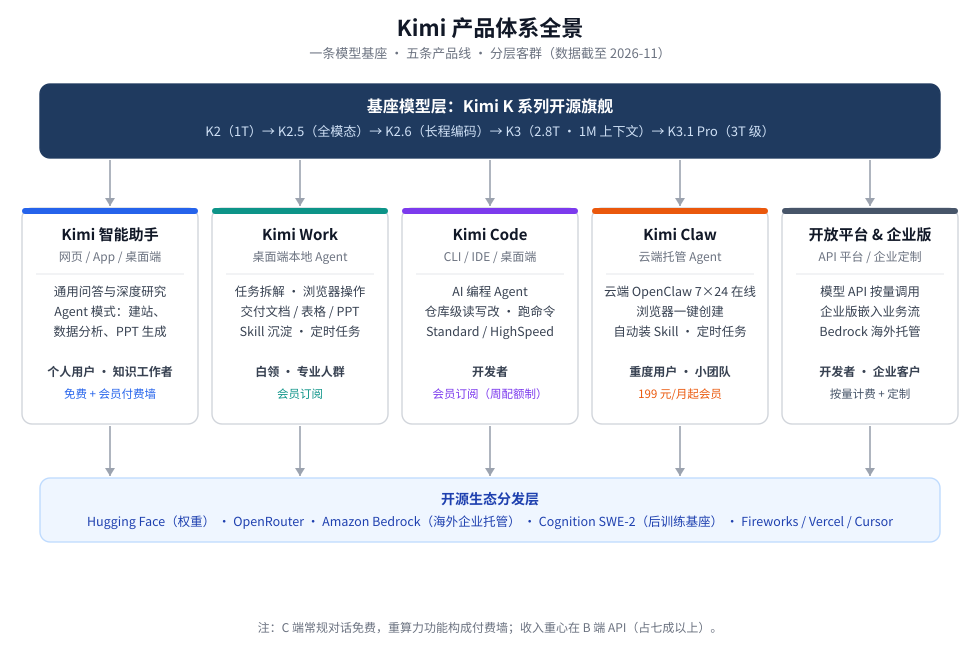

# Kimi 产品体系与商业模式

## 一、产品体系：五条产品线

| 产品线 | 形态 | 核心场景 | 目标客户 |
|---|---|---|---|
| Kimi 智能助手 | 网页版 / App / 桌面端 | 通用问答、深度研究、Agent 模式（建站、数据分析、PPT 生成） | 个人用户、知识工作者；基础对话免费，高消耗功能付费 |
| Kimi Code | 终端 CLI、VS Code 插件、JetBrains/Zed 接入、桌面客户端 | AI 编程 Agent：读代码库、跨文件修改、执行命令；统一模型 ID 直连旗舰编程模型，分 Standard / HighSpeed 双档 | 开发者；会员订阅制，额度按周刷新 + 5 小时滚动窗口 |
| Kimi Work | 桌面端（2026-06 发布） | 通用本地 Agent：拆解任务、操作浏览器、处理文件，交付文档 / 表格 / PPT；支持 Skill 沉淀与定时任务 | 非技术的知识工作者、白领与专业人群 |
| Kimi Claw | 云端托管（2026-02 上线） | 基于 OpenClaw 的 7×24 在线云端 Agent，浏览器一键创建，自动装 Skill、跑定时任务 | 重度个人用户、小团队；绑定 199 元/月以上会员 |
| 开放平台与企业服务 | API 平台 + Kimi 企业版 + Amazon Bedrock 海外托管 | 模型 API 调用、企业定制部署、经第三方云分发 | 开发者、企业客户 |

## 二、商业模式：三条收入线

**1. C 端会员订阅。** "登月计划"四档：Andante 49 元 / Moderato 99 元 / Allegretto 199 元 / Allegro 699 元每月。常规对话免费，Agent、深度研究、编程、云端 Claw 等重算力功能构成付费墙。但 C 端是展示窗口而非利润支柱：月活已从 2024 年 11 月峰值约 3600 万主动收缩至 2026 年 6 月的约 729 万，公司砍投放、停拉新，把算力让给付费用户。

**2. B 端 API（收入主力）。** 按 token 计费，占收入七成以上，客户以数据平台类为主。ARR 从 2026 年 3 月的 1 亿美元增至 6 月的约 3 亿美元。定价随模型代际上移：K3 输出价 100 元/百万 token，较前代涨 3.5 倍，为国内最贵一档，仍不到 Anthropic 旗舰的一半——用榜单位势换定价权，走价值定价而非低价内卷。

**3. 生态与企业分发。** 开源旗舰模型（K3 为全球首个 3T 级开源模型）换取全球开发者生态：Cognition SWE-2 以其为后训练基座，Fireworks、Vercel、Cursor 等平台接入，Bedrock 提供海外企业级托管通道；自托管成本极高的中小团队最终回流官方 API。海外收入已超过国内，并通过租用欧洲云算力支撑增长。

三条线的关系：开源模型做杠杆，C 端免费能力做获客漏斗，收入重心在 B 端 API 与生态分发。
